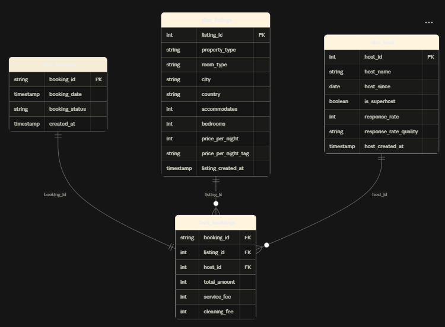

<p align="center">
  
</p>

<h1 align="center">End-to-End Analytics Engineering Pipeline</h1>

<p align="center">
  A production-style analytics engineering project built with
  <strong>dbt</strong>, <strong>Snowflake</strong>, and <strong>AWS S3</strong>.
</p>

<p align="center">
  
  
  
</p>

---

## Overview

This project implements an end-to-end analytics engineering pipeline using the
**Medallion Architecture**. Raw data lands in AWS S3, is loaded into Snowflake,
transformed with dbt, and published as a **Star Schema** for analytics and BI.

**Highlights**

- Metadata-driven, Jinja-generated SQL for the Gold layer
- Incremental models and reusable macros
- Star Schema with one fact table and three dimension tables
- Generic data quality tests on keys, relationships and accepted values
- SCD Type 2 history tracking via dbt snapshots

## Architecture

<table align="center">
  <tr>
    <td align="center" width="200">
      
    </td>
    <td align="center" width="110"><sub>extract &amp; load</sub><br/>➜</td>
    <td align="center" width="200">
      
    </td>
    <td align="center" width="110"><sub>transform</sub><br/>➜</td>
    <td align="center" width="200">
      
    </td>
  </tr>
  <tr>
    <td align="center"><strong>AWS S3</strong></td>
    <td></td>
    <td align="center"><strong>Snowflake</strong></td>
    <td></td>
    <td align="center"><strong>dbt</strong></td>
  </tr>
  <tr>
    <td align="center"><sub>Source<br/>Raw files landing zone</sub></td>
    <td></td>
    <td align="center"><sub>Warehouse<br/>Hosts Bronze, Silver &amp; Gold</sub></td>
    <td></td>
    <td align="center"><sub>Transformation<br/>Models, tests &amp; snapshots</sub></td>
  </tr>
  <tr>
    <td colspan="5" align="center">
      <br/>
      
      &nbsp;&nbsp;
      
      <br/>
      <sub><strong>Git / GitHub</strong> · Version control and development (VS Code / GitHub Codespaces)</sub>
    </td>
  </tr>
</table>

### Medallion Layers

| Layer | Purpose | Models |
|-------|---------|--------|
| 🥉 **Bronze** | Raw ingestion, minimal transformation, history preserved | `bronze_bookings`, `bronze_hosts`, `bronze_listings` |
| 🥈 **Silver** | Cleaned, typed, standardized, with business logic | `silver_bookings`, `silver_host`, `silver_listings` |
| 🥇 **Gold** | Business-ready Star Schema (facts and dimensions) | `one_big_table`, `fact`, ephemeral `dim_bookings`, `dim_host`, `dim_listings` |

## Data Source

- **Dataset:** Airbnb-style booking data with three entities: **bookings**, **listings** and **hosts**.
- **Ingestion:** Raw files land in AWS S3 and are loaded into Snowflake, where dbt reads them through the sources defined in `models/sources/sources.yml`.

## Star Schema

The Gold layer first joins the Silver tables into a single wide table (`one_big_table`), then splits it into one fact table and three dimensions.

<p align="center">
  
</p>

| Table | Type | Grain / contents |
|-------|------|------------------|
| `dim_bookings` | Dimension | One row per booking: date, status, created timestamp |
| `dim_listings` | Dimension | One row per listing: property type, room type, location, capacity, price tier |
| `dim_host` | Dimension | One row per host: name, tenure, superhost flag, response rate and quality |
| `fact` | Fact | One row per booking: keys to the three dimensions plus amounts and fees |

## Project Structure

```text
awsS3_snowflake_dbtCore_project/
├── models/
│   ├── sources/            # Source definitions (sources.yml)
│   ├── 1.bronze/           # Raw layer
│   ├── 2.silver/           # Cleaned layer
│   ├── 3.gold/             # one_big_table, fact, and ephemeral/ dimension models
│   ├── demo/               # Practice models
│   └── tests.yml           # Generic data quality tests
├── macros/                 # Reusable Jinja/SQL (schema naming, tagging, helpers)
├── snapshots/              # SCD Type 2 configurations for the dimensions
├── analyses/               # Ad-hoc exploration queries
├── seeds/                  # Static reference data
├── tests/                  # Singular tests (none yet)
└── dbt_project.yml
```

## Key Features

**Metadata-driven SQL.** The Gold layer builds its joins from a Jinja config list (table, columns, alias, join condition) instead of hand-written SQL. Adding a table means adding one entry to the list:

```sql


SELECT
    
        {{ item['columns'] }},
    
FROM ...
```

**Incremental loading.** Large models process only new or changed rows (simplified example):

```sql
{{ config(materialized='incremental') }}

select * from {{ source('staging', 'bookings') }}

  where created_at > (select coalesce(max(created_at), '1900-01-01') from {{ this }})

```

**Reusable macros.** Business logic lives in macros instead of being copy-pasted across models.

**Ephemeral dimensions.** The dimension models are ephemeral, so dbt inlines them as CTEs instead of creating extra tables in Snowflake.

**Slowly Changing Dimensions (Type 2).** Snapshots on `dim_bookings`, `dim_hosts` and `dim_listings` track historical changes with valid-from / valid-to dates.

**Schema organization.** A custom `generate_schema_name` macro routes each layer to its own schema (`MEDALLION_BRONZE`, `MEDALLION_SILVER`, `MEDALLION_GOLD`).

## Data Quality

Generic tests are defined in `models/tests.yml`:

- `not_null` and `unique` on primary keys
- `relationships` tests between bookings, listings and hosts
- `accepted_values` on categorical columns such as booking status, property type, room type and the superhost flag

## Getting Started

**Prerequisites:** Python 3.9+, a Snowflake account, and access to the S3 data (or sample files).

```bash
git clone https://github.com/labbdogg/dbt-analytics-platform.git
cd dbt-analytics-platform
python -m venv .venv && source .venv/bin/activate   # Windows: .venv\Scripts\Activate.ps1
pip install dbt-snowflake
cd awsS3_snowflake_dbtCore_project
```

Add this to `~/.dbt/profiles.yml` (never commit credentials). The profile name must match `profile:` in `dbt_project.yml`:

```yaml
awsS3_snowflake_dbtCore_project:
  target: dev
  outputs:
    dev:
      type: snowflake
      account: <account_identifier>
      user: <user>
      password: "{{ env_var('SNOWFLAKE_PASSWORD') }}"
      role: <role>
      warehouse: <warehouse>
      database: <database>
      schema: <schema>
      threads: 4
```

Run it from the `awsS3_snowflake_dbtCore_project` folder:

```bash
dbt debug                               # verify connection
dbt build                               # models + tests + snapshots
dbt run --select 1.bronze               # or 2.silver / 3.gold
dbt run --full-refresh                  # rebuild incremental models
dbt docs generate && dbt docs serve     # docs and lineage
```

## Data Lineage

dbt builds a DAG of model dependencies automatically. Run
`dbt docs generate && dbt docs serve` to explore this project's lineage locally.

## Future Enhancements

- [ ] CI/CD with automated `dbt build` on pull requests
- [ ] Singular business-rule tests in `tests/`
- [ ] Data quality dashboards and alerting
- [ ] BI layer on top of the Gold models

## Project Objective

Demonstrate how dbt can turn raw data into a reliable, scalable, business-ready
analytics layer using modular transformations, dimensional modeling, automated
testing, incremental processing, and historical tracking.